<div align="center">

# Organizer

**Inventory, mail and to-dos for your workshop.**<br>
One app. Your own server. No subscriptions.

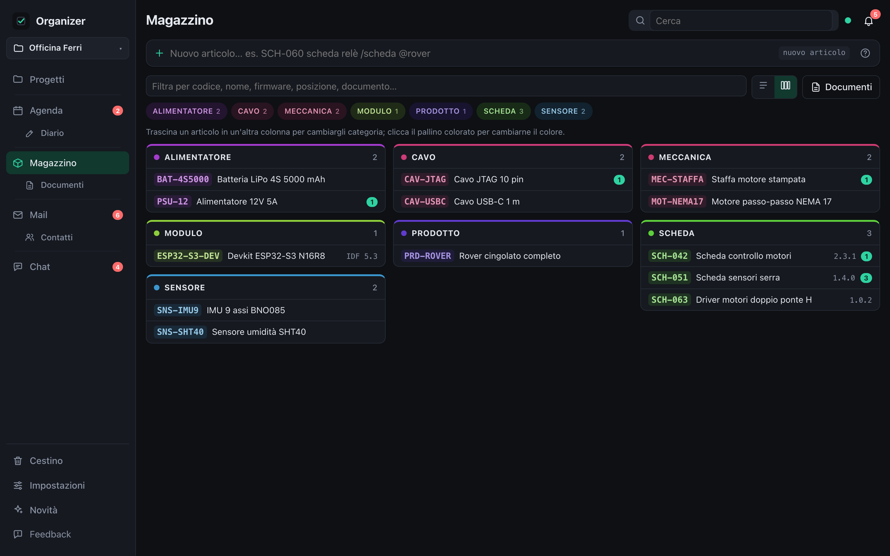

</div>

You have part numbers, boards, firmware, datasheets.
You have mail that gets lost, to-dos everywhere, and colleagues asking "where's the JTAG cable?".

Organizer puts it all in one place, and links it together.
Type `SCH-042` in a mail, a to-do or the chat: it becomes a link. The part knows where it was mentioned.

| | |
|---|---|
| 📦 [**Inventory**](#-inventory) | part numbers, locations, stock, firmware, assemblies |
| 📄 [**Documents**](#-documents) | PDF, 3D and DXF, with notes pinned to the right spot |
| 📬 [**Mail**](#-mail) | Thunderbird, threaded conversations, everything linked |
| ⚡ [**Quick capture**](#-quick-capture) | one line for a to-do, with due date and people |
| 💬 [**Chat**](#-chat) | channels, mentions, push notifications |
| 🔧 [**Setup**](#-under-the-hood) | runs on your machine, up in a minute |

> The app speaks English and Italian (Settings → App and help → Language). The screenshots show the Italian interface, with made-up data.

---

## 📦 Inventory

Every part has its code, location, quantity and firmware version.
Categories are colored columns: drag a part to move it.

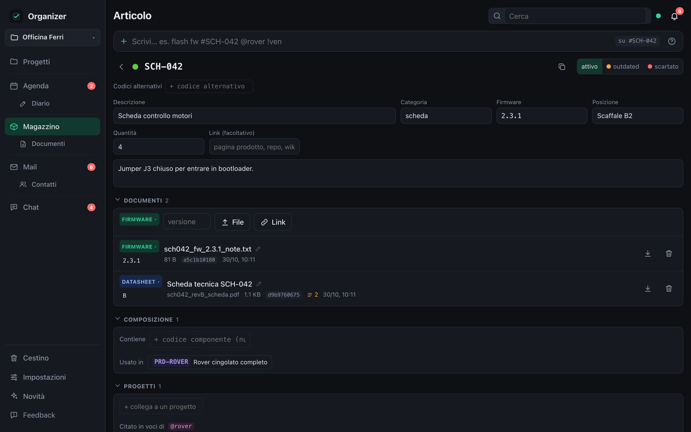

- **Alternative codes**: the supplier's code leads to the same part.
- **Assemblies**: the rover contains the board, the battery, the bracket.
- **Documents** with versions: firmware, datasheets, schematics, footprints.
- Forgiving search: `sch42` finds `SCH-042`.

## 📄 Documents

PDFs, images, 3D models and DXF drawings open right in the app.
Click a spot, leave a note. On that hole, on that line.

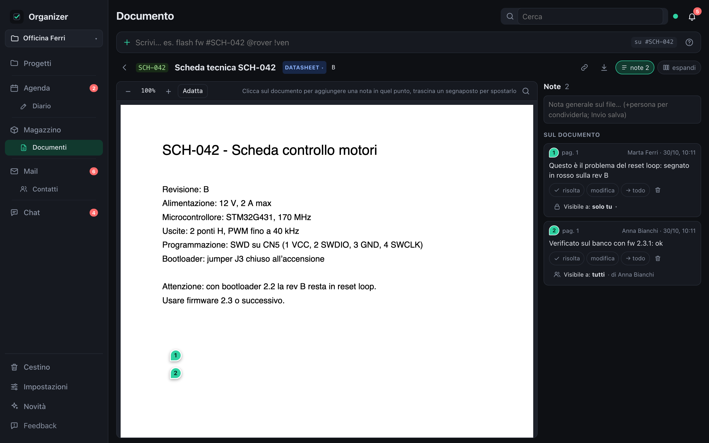

<table>
<tr>
<td width="50%">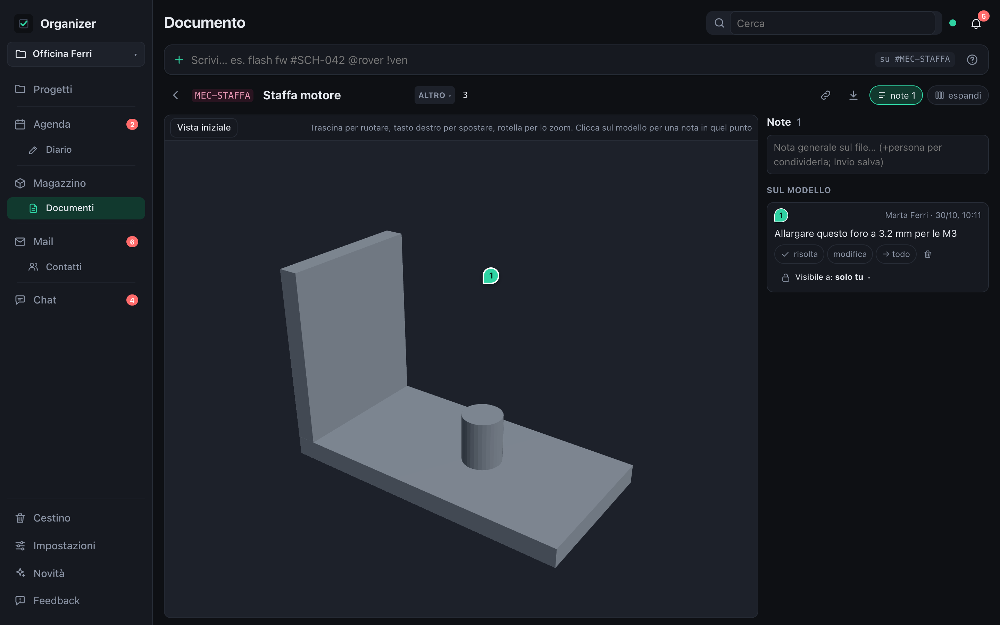<br><b>STL, STEP, 3MF</b>: rotate it, annotate it.</td>
<td width="50%">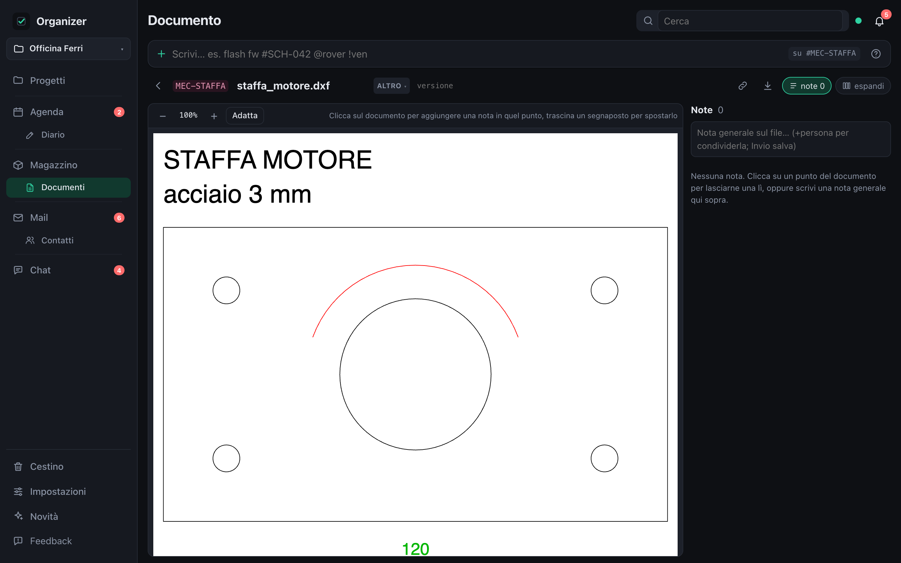<br><b>DXF</b>: technical drawings, zoom up to 12×.</td>
</tr>
</table>

Notes are private until you share them. One click turns a note into a to-do.

## 📬 Mail

Organizer never sees your mail passwords. It works through Thunderbird, with an add-on.

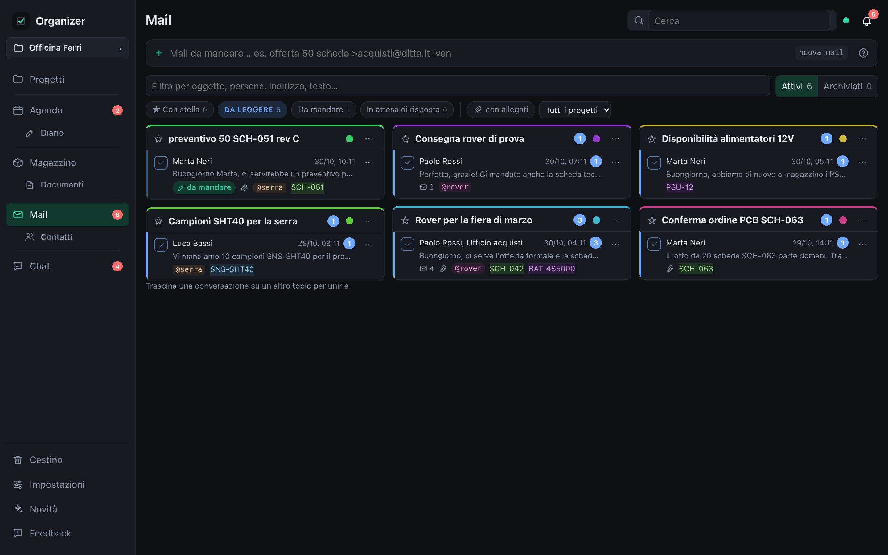

- **Topics and conversations**: mail groups itself, even when Outlook drops the references.
- **Drag** one conversation onto another topic to merge them.
- **Archive** what's done. It comes back by itself when someone replies.
- **First run**: loads the last month of mail. You archive, it keeps track.

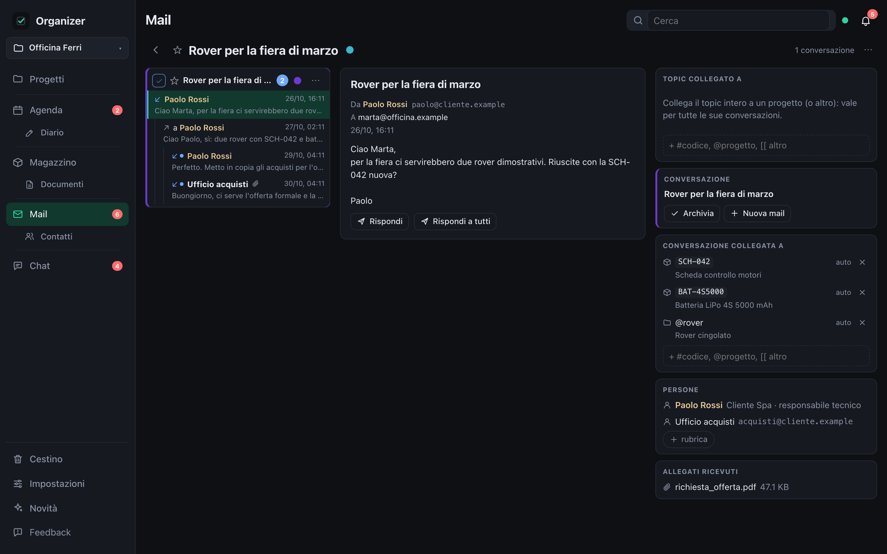

The thread tree on the left, like a forum. The message in the middle. Links on the right.

- Part numbers and projects mentioned in mail **link themselves**. Wrong link? Click the ×.
- **Reply** from Organizer: it goes out through Thunderbird, with files from your inventory attached.
- Got an attachment? **→ inventory**, pick the part, done.
- Your mail is **yours only**. Not even admins can see it.

## ⚡ Quick capture

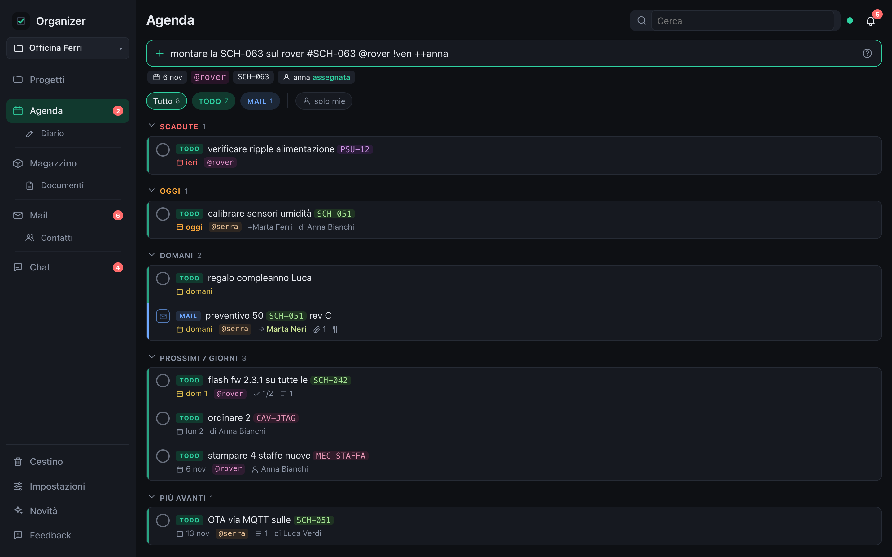

| Type | You get |
|---|---|
| `#SCH-063` | a link to the part |
| `@rover` | filed under the project |
| `!fri` `!tomorrow` `!3d` | due Friday, tomorrow, in 3 days |
| `+anna` | shared with Anna |
| `++anna` | shared and assigned to her |
| `m:` `n:` | a mail to send, a journal note |

The preview underneath shows what you typed before you hit Enter.

## 🗂️ Projects

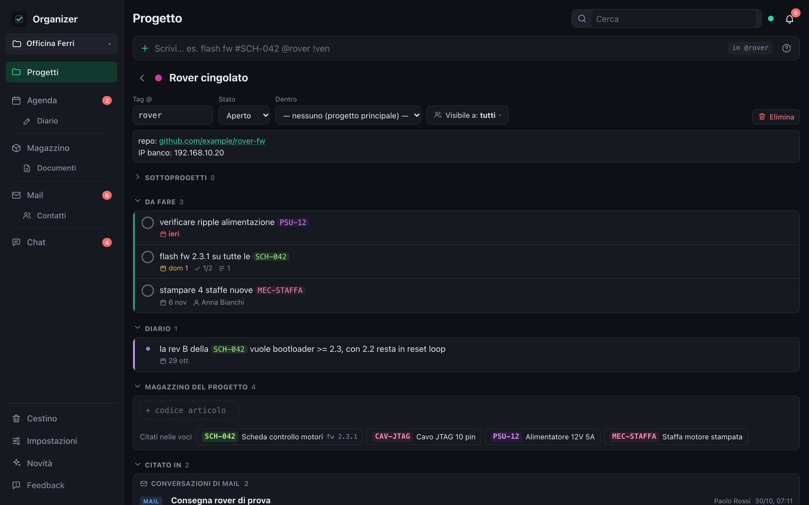

To-dos, journal, mail, parts used. Everything tagged `@rover`, on one page.
Subprojects, status, colors.

## 💬 Chat

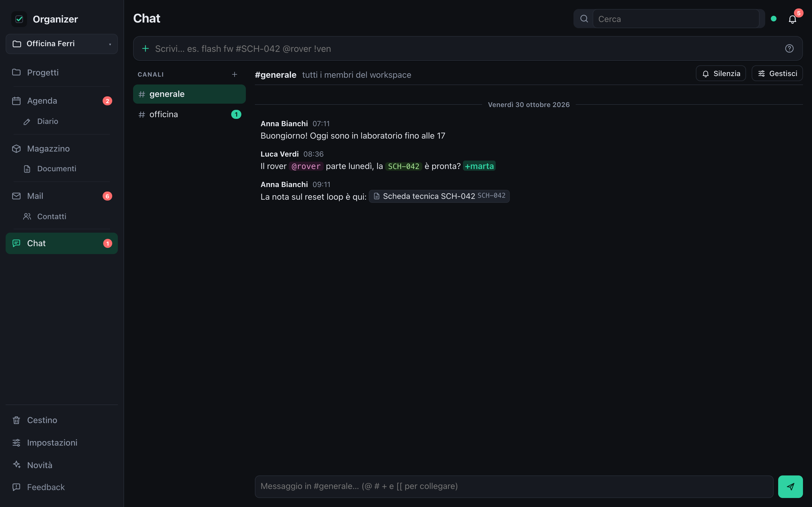

Channels for everyone or for a few. `+marco` pings Marco. `[[` links a document, a to-do, a mail.
Notifications on your phone, even with the app closed.

## 📱 Mobile

Install it as an app from Safari or Chrome. To-dos and notes work offline too.

<table>
<tr>
<td width="50%" align="center">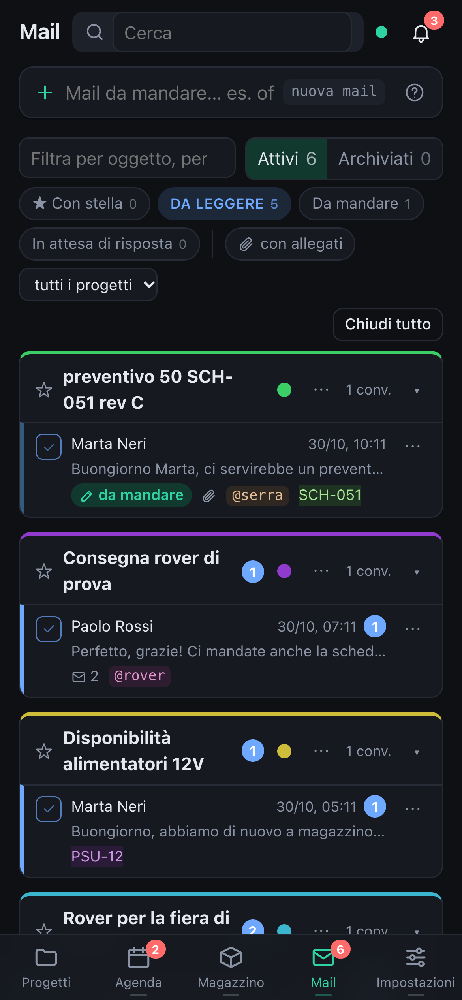</td>
<td width="50%" align="center">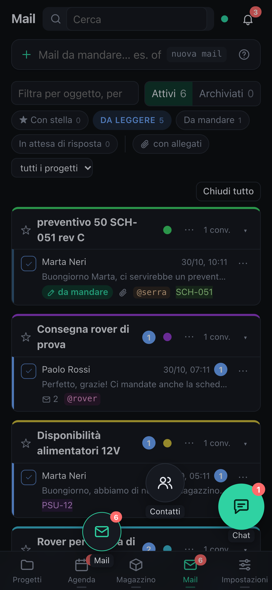</td>
</tr>
<tr>
<td align="center">Collapse the cards, keep just the titles.</td>
<td align="center">Long-press a tab for the radial menu.</td>
</tr>
</table>

## ⌘K

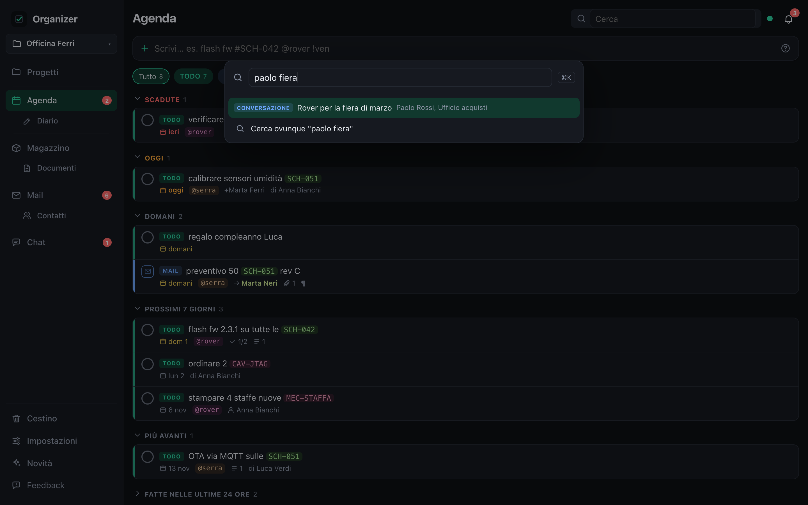

Two words and you're there. `paolo fiera` finds the right mail, even from its body text.
Pages, to-dos, parts, documents, projects, contacts. Hit Enter.

## 🤝 Teams

- **Private by default**. You decide what to share.
- **Workspaces**: work, home, one per client.
- **Permissions** per area, in one clear table.
- **Notifications** when you're mentioned, assigned something, or get mail.
- **Guided tour** for newcomers, in a sandbox workspace.
- **Trash**, for second thoughts.

## 🎨 Themes

Over thirty themes. The editor classics, and a few funky ones.

<table>
<tr>
<td width="50%">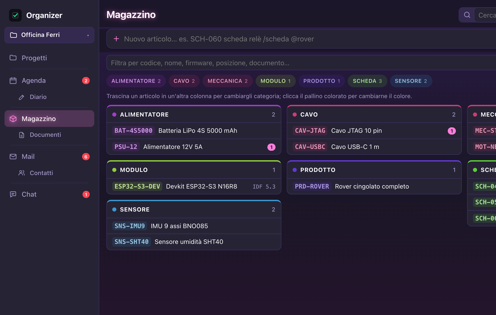<br>Synthwave '84</td>
<td width="50%">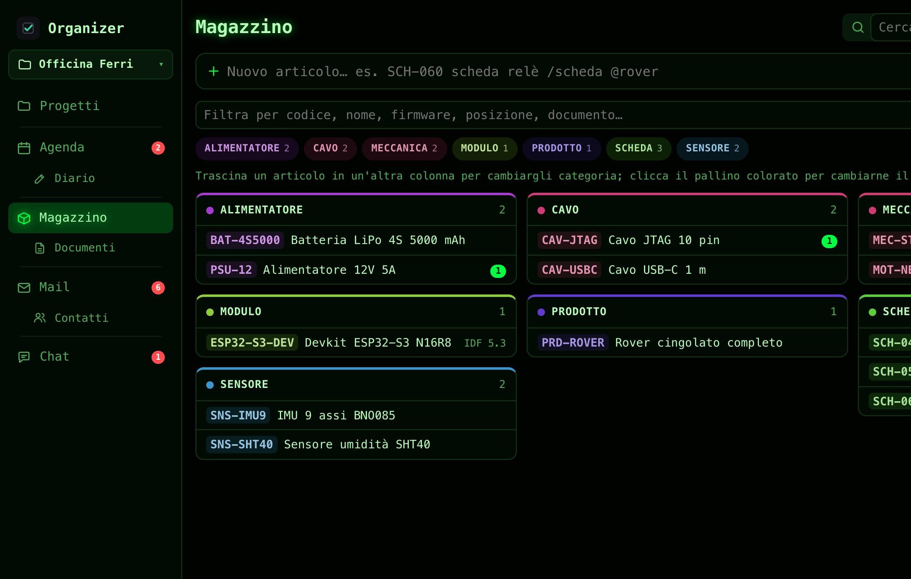<br>Matrix</td>
</tr>
<tr>
<td>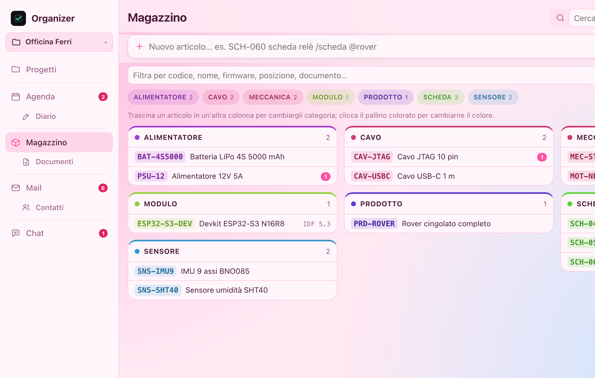<br>Bubblegum</td>
<td>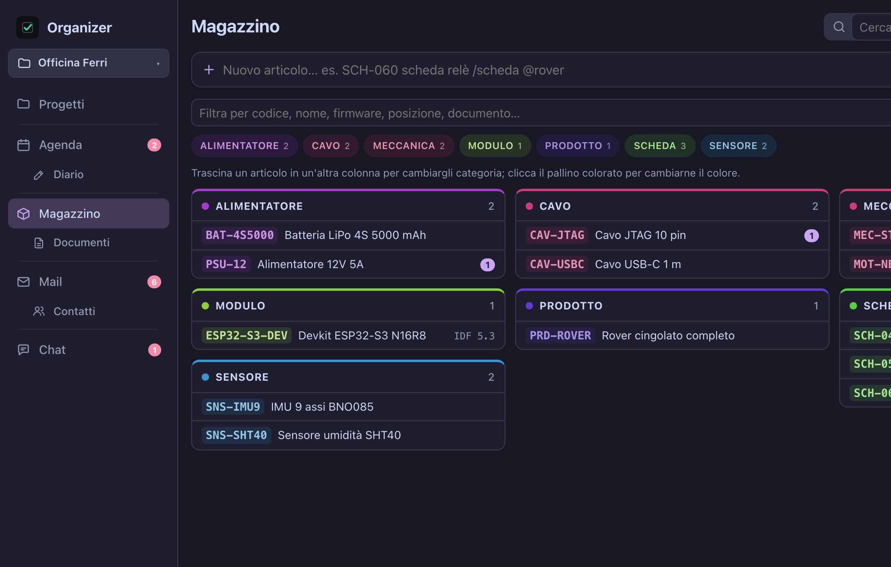<br>Catppuccin Mocha</td>
</tr>
</table>

Tokyo Night, Gruvbox, Nord, Dracula, Monokai, Night Owl, Solarized, GitHub…
Plus Vaporwave, an amber terminal, Halloween, Sorbet. Why not.

---

## 🔧 Under the hood

### Your machine, your data

Node.js + SQLite, nothing else to install. Runs in Docker on a Mac mini, a Raspberry Pi, an office server.

```bash
make up        # http://localhost:8080
make demo      # sample data (wipes existing data)
make backup    # everything into backups/
make tunnel    # reach it from your phone, anywhere, via Cloudflare Tunnel
```

### From the terminal: `org`

```bash
org add 'flash fw 2.3.1 #SCH-042 @rover !fri +marco'
org ls -p rover --late
org item show SCH-042
org doc up SCH-060 fw_1.1.bin -V 1.1
org mail new 'send firmware #SCH-060 >purchasing@supplier.example'
```

Everything you do in the app, from the terminal. Guide: [cli/README.md](cli/README.md).

### Open API

One token, and your tools can talk to Organizer: bots, scripts, the test bench.

```bash
curl -X POST http://localhost:8080/api/entries \
  -H "Authorization: Bearer $TOKEN" -H 'Content-Type: application/json' \
  -d '{"text":"test failed #SCH-042 !today"}'
```

Endpoints and examples: [docs/API.md](docs/API.md).

---

## 📚 More

- [Full guide](docs/GUIDE.md): every feature, page by page.
- [Install and remote access](docs/DEPLOY.md): domain, tunnel, phone.
- [API](docs/API.md) · [CLI](cli/README.md) · [Changelog](CHANGELOG.md)

## License

Organizer is free software under the [GNU Affero General Public License v3.0](LICENSE): you can use, study, change and share it; if you offer a modified version as a service, you share its source too.
The bundled libraries keep their own licenses: see [THIRD-PARTY.md](THIRD-PARTY.md).

<div align="center">
<sub>Made in a workshop, for the workshop. 🔧</sub>
</div>
